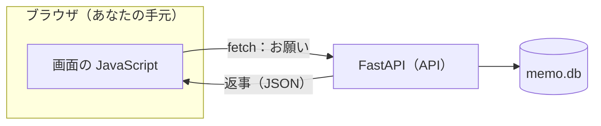
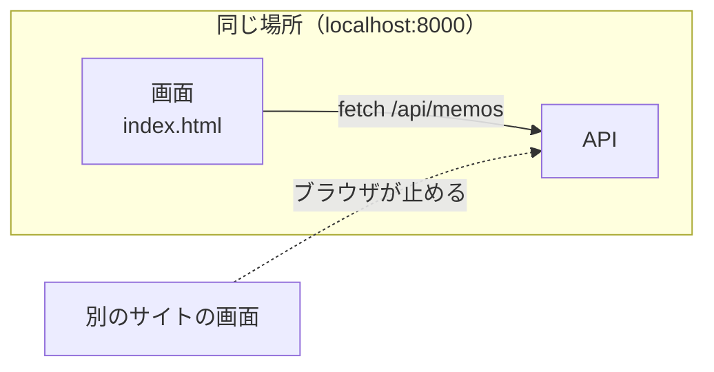
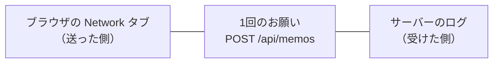

# 7-2 画面をつなぐ HTML＋JS

所要 30分 ／ 種類：作る

## 今日のゴール
- ブラウザの画面から、7-1 で作った**自分の API** を `fetch` で呼ぶ
- DevTools の Network タブとサーバーのログで、**同じ1回のお願いを両側から**見る
- 画面と API を同じ場所から配る理由（CORS）が分かる

第3部では、他人のサイトの裏側を覗きました。今日は「覗かれる側」を自分で作ります。

## ステップ

### 1. 画面はブラウザ、メモはサーバー

- **前提**：画面の JavaScript は**ブラウザの中**で動きます。メモの本体は**サーバーの `memo.db`** にあります。ブラウザは、自分から頼まないとサーバーの中身を見られません
- **困りごと**：メモを画面のコードに直接書いておくと、追加しても保存されず、リロードで消えます
- **解決**：`fetch` で窓口（API）に頼みます。`fetch` は「ブラウザから、URL を指定してサーバーにお願いを送る」命令です
- 7-1 であなたが打った `curl` が、画面の中に引っ越してきたもの、と考えてください

**確かめ**：あとで、Mac の画面で追加したメモが、別の端末の画面にも出るようになります。なぜ？ ボタン：`2つの画面どうしが、メモを送り合うから` / `どちらの画面も、同じ API に聞きに行くから`
<!-- 先生用：同じ API に聞きに行くから。メモは画面ではなくサーバーの memo.db にある。間違えたら図を指して「画面どうしは直接話していない。どちらも同じ窓口に聞きに行っているだけ」と言い直す -->

### 2. 画面も API と同じ場所から配る（CORS）

- **前提**：ブラウザには、あなたのログイン状態などが残っています
- **困りごと**：悪いサイトの画面が、その状態を使って**別のサイト**のデータを勝手に読めたら危険です
- **解決**：ブラウザは、ある場所の画面から**別の場所**への呼び出しを、初期設定で止めます。この仕組みを **CORS**（**C**ross-**O**rigin **R**esource **S**haring：別の場所への呼び出しを、許可したものだけ通すルール）と呼びます
- 画面と API を**同じ FastAPI から**配れば、同じ場所（同じ `localhost:8000`）なので止められません

**やってみよう**：あなたのタブで、画面のできかけをコピーします（いまのタブが `playground/capstone` にいたら、先に `cd ../..` でコースのフォルダに戻ります）。

```bash
mkdir -p playground/capstone/static
cp lessons/07-capstone/02-frontend/starter/index.html playground/capstone/static/
```

**確かめ**：もし画面を GitHub Pages（4-6）に置き、API は Mac に置いたままにしたら、画面からの `fetch` は？ ボタン：`ふつうに届く` / `届かない`
<!-- 先生用：届かない。別の場所どうしになるので、ブラウザが止める（CORS の許可が要る）。さらに、Mac の localhost には外から届かない（0-3）。両方の理由がある。間違えたら図の点線（ブラウザが止める）を指して言い直す。7-6 で実際にこの形にするときに、API 側で「この画面からは許可」と設定する、と予告する -->

### 3. FastAPI に、画面も配ってもらう
**やってみよう**：`playground/capstone/main.py` の**一番下**に、この2行を足して保存します。

```python
from fastapi.staticfiles import StaticFiles
app.mount("/", StaticFiles(directory="static", html=True), name="static")
```

- 「`/` に来たお願いは、`static` フォルダのファイルで返す」という意味です
- FastAPI は、お願いが来ると**上から順に**、担当を探します。最初に当てはまったものが返事をします
- `/` は「全部」に当てはまります。だから**一番下**に書きます

実験（やってもやらなくてもOK）：2行を `app = FastAPI()` のすぐ下に移して保存し、ブラウザで `http://localhost:8000/api/memos` を開いてみましょう。終わったら一番下に戻します。

### 4. TODO を埋める：curl を fetch に訳す
`static/index.html` を開くと、`TODO 1`〜`TODO 3` があります。`fetch(...)` で API を呼ぶ場所です。

| 7-1 の curl | fetch では |
|---|---|
| `curl localhost:8000/api/memos` | `fetch(URL)`（何も指定しなければ GET） |
| `-X POST` | `method` |
| `-H 'Content-Type: ...'` | `headers` |
| `-d '{"text":...}'` | `body` |

- 返事は `await res.json()` で、JSON の文字から JavaScript のデータに戻します
- 送るときは逆に `JSON.stringify(...)` で、データを JSON の**文字**にします。通信で送れるのは文字だけだからです（1-2「ファイルはただの文字」、2-3 の JSON）
- `await`＝「返事が来るまで待ってから、次の行へ」

**やってみよう**：`TODO 1`（一覧の GET）、`TODO 2`（追加の POST）、`TODO 3`（削除の DELETE）を埋めて保存します。

### 5. ブラウザで動かして、両側から見る


**やってみよう**：
1. サーバーが止まっていたら、先生がサーバー用のタブで `uv run uvicorn main:app --port 8000 --reload` を動かします
2. ブラウザで `http://localhost:8000` を開き、メモを追加・削除してみます
3. 右クリック→「検証」で DevTools を開き、**Network** タブを出したまま、もう1件追加します
4. `memos` という行をクリックして、Headers の **Request Method** が `POST`、Payload に `{"text": ...}` があるのを見ます
5. サーバーのタブにも、同じ時刻に `POST /api/memos` の行が増えています

**ブラウザの Network とサーバーのログは、同じ出来事を両側から見ている**だけです。

### 6. 残るもの、止まるもの
**やってみよう**：
1. ブラウザをリロードします。メモは残っていますか？（`memo.db` に保存されているからです）
2. 先生がサーバーのタブを `Ctrl+C` で止めます。開いたままの画面で、メモを追加してみてください
3. DevTools の **Console** タブに、赤い行が出ます。最後を読みましょう（`Failed to fetch`＝お願いが届かなかった）
4. 先生がサーバーを起動し直します

困ったときも、まず Console の赤い行の最後です。`404` なら URL の綴り、`422` なら送った JSON の形が違っています（1-6 と同じく、エラーは下から読む）。

## チェック
`/check`：`/` で画面が返り、API も動き、`index.html` に GET・POST・DELETE の `fetch` が書けていれば合格。
（ブラウザで本当に動くかは、ステップ5で自分の目で確かめたとおりです）

## AIとの関係
Claude に「画面も付けて」と頼むと、ほぼ必ずこの形（HTML 1枚＋`fetch`）が出てきます。Claude が書いた `fetch` を見つけて「これは GET か POST か」と読めれば、画面と API の会話が分かります。おかしいときは、**Network タブとサーバーのログを並べて見る**のが最短です。
