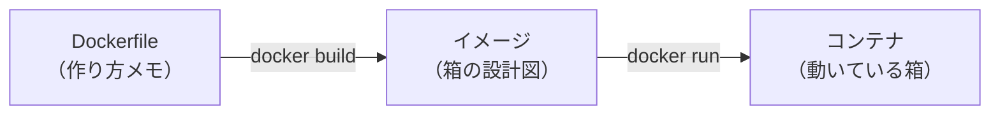
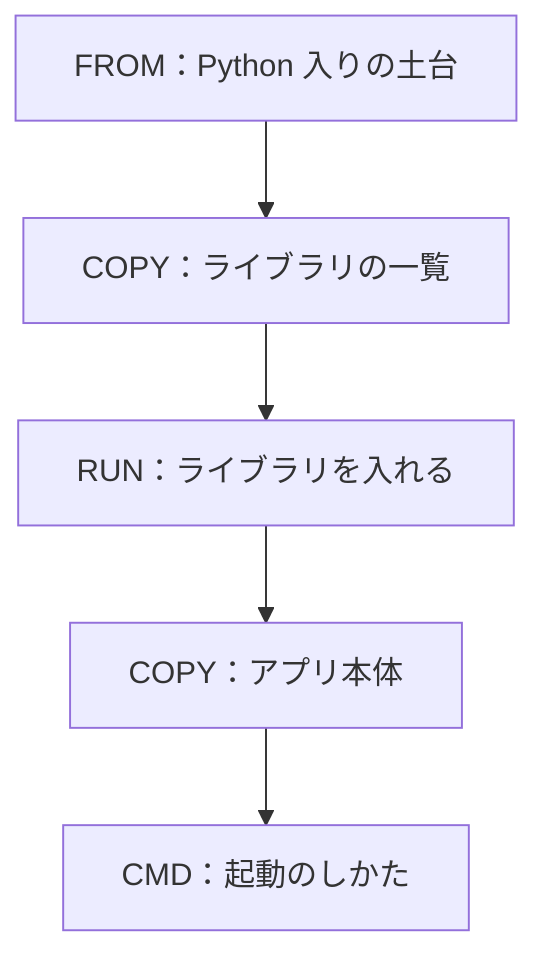
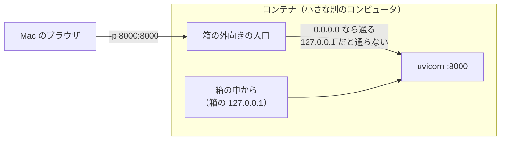
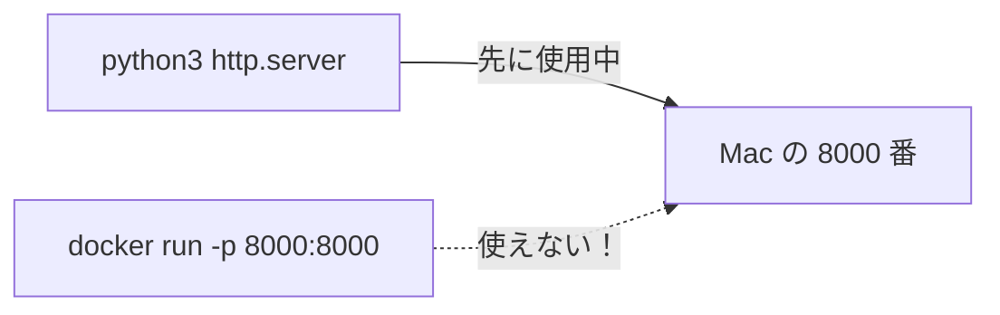
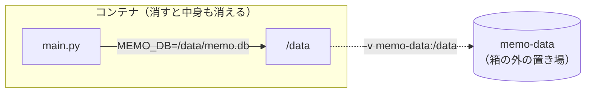

# 7-3 Docker に入れる

所要 40分 ／ 種類：作る

## 今日のゴール
- メモアプリの箱の作り方メモ（Dockerfile）を自分で書き、`docker build` → `docker run` で動かす
- 「ポートがすでに使われています」に一度出会って、`lsof` と `kill` で自分で直す
- 箱を消すとメモも消える理由と、残す方法が分かる

## ステップ

### 1. 箱の作り方メモを用意する

- **前提**：アプリは、Python のバージョンやライブラリなど、**動かす環境**に頼っています。マシンごとに環境は少しずつ違います
- **困りごと**：「自分の Mac では動くのに、ほかでは動かない」が起きます
- **解決**：環境ごと箱に詰めます（4-5）。4-5 では、人が作った nginx の箱を借りました。今日は **Dockerfile に「何を入れて、どう起動するか」を自分で書き**、自分の箱を作ります

**やってみよう**：
1. Docker Desktop のアプリを開いておきます。あなたのタブで `docker ps` を打ち、表が出れば準備OK（エラーなら、まだ起動中かもしれません）
2. 続けて、できかけをコピーして、中を見ます（コースのフォルダにいる状態で。`playground/capstone` にいたら `cd ../..`）

```bash
cp lessons/07-capstone/03-docker/starter/Dockerfile lessons/07-capstone/03-docker/starter/.dockerignore playground/capstone/
cd playground/capstone
ls -a
cat .dockerignore
```

- `ls -a`＝all。`.` で始まる隠れたファイルも見せる
- `.dockerignore` は「箱に入れないもの」のリストです。`.venv`（**v**irtual **env**ironment：Python の作業部屋）や `memo.db` が書いてあります

<!-- 先生用：7-2 のサーバーが 8000 番で動いていたら、このステップの最初に止めておく -->

### 2. Dockerfile を書く：変わらないものから先に

- **前提**：`docker build` は Dockerfile を**上から1行ずつ**実行し、1行ごとに層を積みます。前回と同じ行は、作り直さずに使い回します（キャッシュ）
- **困りごと**：アプリ本体を先にコピーすると、`main.py` を1行直すたびに、その下の「ライブラリを入れる」もやり直しになり、遅くなります
- **解決**：**変わりにくいもの（ライブラリの一覧）を上、よく変わるもの（アプリ本体）を下**に置きます

**やってみよう**：`Dockerfile` を開いて、`TODO 1`〜`TODO 3` を埋めます（`TODO 4` は次のステップ）。
- `COPY 元 先`＝Mac のファイルを、箱の中にコピーする
- `RUN コマンド`＝箱を作る途中で、コマンドを実行する
- `TODO 1`：`pyproject.toml` と `uv.lock`、`TODO 2`：`uv sync`、`TODO 3`：`main.py` と `static`

### 3. どこで待つか：`--host 0.0.0.0`

- **前提**：0-3 で見たとおり、`127.0.0.1`（`localhost`）は「自分自身」です。そしてコンテナは、**小さな別のコンピュータ**のようなもの。箱の中の `127.0.0.1` は、**箱自身**です
- **困りごと**：uvicorn を `127.0.0.1` で待たせると、箱の中からのお願いしか受け付けません。Mac から `-p` でつないで来たお願いは、箱の**外向きの入口**から入ってくるので、断られます
- **解決**：`--host 0.0.0.0` にします。`0.0.0.0`＝「どの入口から来ても受け付ける」という意味です

**やってみよう**：
1. `TODO 4` の `CMD` を埋めます。形は `CMD ["uvicorn", "main:app", ...]` で、コマンドを1語ずつ `" "` で囲んで並べます。`--host` と `--port` も忘れずに
2. あなたのタブで箱を作ります：`docker build -t memo .`
   - `-t`＝tag（名札）。この箱に `memo` という名前を付ける
   - 最後の `.`＝「このフォルダの Dockerfile を使う」
3. `docker images` で、`memo` ができたのを確かめます

### 4. ポートがぶつかる

- **前提**：1つのポート（窓口の番号）は、1つのプログラムしか使えません（4-1）
- 今日は、わざとぶつけて、自分で直します。Claude も、よくこれを踏みます

**やってみよう**：
1. 先生が別のタブを開き、`python3 -m http.server 8000` で 8000 番をふさぎます
2. あなたのタブで箱を動かします：`docker run -d -p 8000:8000 --name memo memo`
   （`-d`＝detach：裏で動かす、`-p`＝publish：Mac の番号を箱につなぐ。4-5 と同じ）
3. エラーの最後の行を読みます（`address already in use` や `port is already allocated`）
4. 犯人を探します：`lsof -i :8000`（`lsof`＝list open files）。`python3` の行の **PID**（プロセスの番号）が犯人です
5. `kill PID`（PID は数字に置き換え）で止めて、もう一度 `lsof -i :8000`。何も出なければ成功です

### 5. 抜け殻を片付けて、動かす
**やってみよう**：
1. さっきと同じ `docker run -d -p 8000:8000 --name memo memo` を、もう一度打ちます。今度は**別のエラー**が出ます。読んでみましょう
2. `docker ps -a`（`-a`＝all：止まっているものも見せる）を打つと、失敗した `memo` の**抜け殻**が残っています。名前 `memo` はこれが使っています
3. 片付けて、やり直します

```bash
docker rm memo
docker run -d -p 8000:8000 --name memo memo
```

4. ブラウザで `http://localhost:8000` を開いて、メモを追加します
5. 先生がログ用のタブを開き、`docker logs -f memo` を流します（`-f`＝follow：追いかける）。ブラウザで追加・削除するたびに、`POST /api/memos` や `DELETE` の行が流れます

**確かめ**：`-p 8000:8000` を `-p 8080:8000` に変えて動かしたら、ブラウザでは何番を開く？ ボタン：`8080` / `8000`
<!-- 先生用：8080。左が Mac 側の番号、右が箱の中の番号。箱の中の uvicorn は 8000 のまま。間違えたら「Mac の 8080 番の窓口に来たお願いを、箱の 8000 番へ回す、という意味。ブラウザが叩くのは Mac 側の番号」と言い直す。試したい人は docker rm -f memo してから 8080:8000 で動かし、終わったら 8000:8000 に戻す -->

### 6. 箱を消すと、メモも消える

- **前提**：箱の中で作られたファイルは、**箱の中**にあります。`memo.db` も同じです
- **困りごと**：`docker rm` で箱を捨てると、中のメモも一緒に消えます（`docker stop` で止めるだけなら残ります）
- **解決**：箱の外に置き場所を借りて、箱の中の `/data` につなぎます。`-v`＝volume（置き場）

**やってみよう**：あなたのタブで順番に打ちます。

```bash
docker rm -f memo
docker run -d -p 8000:8000 --name memo memo
```
（`rm`＝remove、`-f`＝force：動いていても消す）

1. ブラウザをリロード。メモは**消えています**
2. 次は置き場所つきで動かします：`docker rm -f memo` → `docker run -d -p 8000:8000 -v memo-data:/data --name memo memo`
3. メモを追加 → `docker rm -f memo` → 2 と同じ `docker run` → リロード。今度は残っていますか？

**確かめ**：置き場所つきで動かしたら、`docker rm -f memo` で箱を捨てても、メモが残りました。なぜ？ ボタン：`memo.db が、箱の外の置き場（memo-data）にあるから` / `-v を付けると、docker rm がメモだけは消さないから`
<!-- 先生用：箱の外にあるから。Dockerfile の ENV MEMO_DB=/data/memo.db で、main.py は /data/memo.db に書く。その /data を -v で箱の外の memo-data につないだ。間違えたら図の点線を指して「消えたのは箱だけ。memo.db は最初から箱の外の置き場にあった」と言い直す。4-2 の環境変数がここで効いている -->

## チェック
`/check`：`docker build` と `docker run` ができて、コンテナの中の API が外から動いたら合格。
（Docker が起動していない場合は、そう表示して止まります。Docker Desktop を開いてからもう一度）

## AIとの関係
Claude は「Docker で動かします」とよく言います。そのとき裏でやっているのは、今日の4つ：**Dockerfile を書く → build → run -p → logs**。「ポートが使われています」は Claude もよく踏みます。`lsof` で犯人を探せるあなたは、Claude の報告を待たずに原因が分かります。
