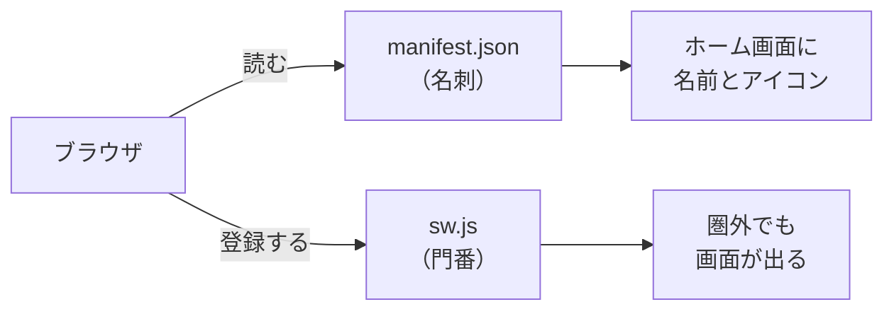
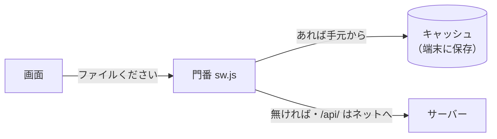
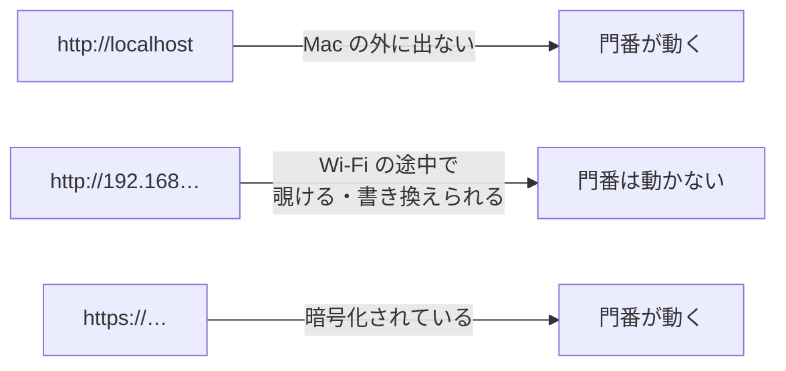

# 7-4 スマホで開く PWA

所要 30分 ／ 種類：作る

## 今日のゴール
- メモアプリに `manifest.json`（名刺）と Service Worker（門番）を足して、Mac で動くのを DevTools で確かめる
- **自分のスマホ**から、Mac で動いているメモアプリを開く
- スマホの `http://192.168…` では本物の PWA にならない理由を、自分の言葉で言える

## ステップ

### 1. アプリの名刺を作る

- **前提**：ふつうの Web ページは、開くたびにサーバーから取ってきます。端末には何も残らず、名前やアイコンもありません
- **困りごと**：電車の中（圏外）では開けず、毎回ブラウザで URL を探すことになります
- **解決**：2つの部品を足して、Web ページをアプリのように振る舞わせます。これが **PWA**（**P**rogressive **W**eb **A**pp）です（4-7）。今日はまず名刺から

**やってみよう**：あなたのタブで部品をコピーします（コースのフォルダにいる状態で）。

```bash
cp lessons/07-capstone/04-pwa/starter/{manifest.json,sw.js,icon.svg} playground/capstone/static/
```

`static/manifest.json` を開いて、`TODO` を埋めます（アプリの名前、短い名前、テーマカラー `#RRGGBB`）。

### 2. 門番（Service Worker）を書く

- 門番は、画面とネットの間に立ちます。画面がファイルを取りに行くたびに割り込んで、「手元から返す？ ネットに取りに行く？」を決めます
- `sw.js` は `static` の一番上に置き、`/sw.js` として配ります。門番が守れるのは、**自分が置かれた場所から下**だけだからです。一番上なら、サイト全体を守れます

**やってみよう**：`static/sw.js` を開いて、`TODO 1`（はじめにファイルを保存）、`TODO 2`（手元にあればそれを返す）を埋めます。コメントにヒントがあります。

### 3. 画面から門番を呼んで、Mac で確かめる
**やってみよう**：
1. `static/index.html` に、2か所足して保存します
   - `<head>` の中（`<title>` の下あたり）に：

     ```html
     <link rel="manifest" href="/manifest.json">
     <meta name="theme-color" content="#2f6fed">
     ```

   - `<script>` の中の一番下に：

     ```js
     if ("serviceWorker" in navigator) {
       navigator.serviceWorker.register("/sw.js");
     }
     ```

     `if` は「この場所で門番が使えるか？」の確認です。使えない場所では `navigator.serviceWorker` そのものが無いので、確かめないとエラーになります
2. 7-3 の箱が 8000 番を使っているので、あなたのタブで `docker stop memo` で止めます
3. 先生がサーバー用のタブで `uv run uvicorn main:app --port 8000 --reload` を動かします
4. ブラウザで `http://localhost:8000` を開き、DevTools の **Application** タブを見ます
   - **Manifest**：名前とアイコンが出ていますか？ 出ていなければ、ここに赤字で理由が出ます
   - **Service Workers**：`activated and is running` になっていますか？

### 4. 門番の実験：オフラインと、キャッシュの罠
**やってみよう**：
1. Application の Service Workers にある **Offline** にチェックを入れて、リロードします。ネットが無いのに、画面が出ます
2. ただし、メモの一覧は空になります
3. **Offline** のチェックを外します。次に、`index.html` の `<title>` を変えて保存し、リロード。**変わりません！**
4. `sw.js` の `memo-v1` を `memo-v2` に変えて保存 → Application の Service Workers で **Update on reload** にチェック → リロード（変わらなければ、もう1回）。今度は変わります

3 は PWA の「あるある」です。門番が、手元の古い画面を先に返していたのです。だから画面を変えたら、`sw.js` の版の名前を上げます。新しい版の門番は、入れ替わるときに古い版の保存（`memo-v1`）を片付けます（`sw.js` の `activate` の部分）。

<!-- 先生用：どうしても古いままなら、Application → Storage → Clear site data で全部消してリロード。終わったら Update on reload のチェックは外してよい -->


**確かめ**：オフラインで画面は出たのに、メモの一覧は出ませんでした。なぜ？ ボタン：`オフラインでは、JavaScript が動かないから` / `一覧は /api/ へのお願いで、手元に保存していないから`
<!-- 先生用：/api/ は保存していないから。画面のファイルは門番が手元（キャッシュ）から返したが、一覧はステップ2のとおりキャッシュしない設計なので、ネットに取りに行って失敗した。間違えたら「画面は出た＝JavaScript は動いている。門番の図の『/api/ はネットへ』の矢印を見て」と言い直す。オフラインでもメモを見たいなら？は、7-5 で Claude と考えてみてもよい -->

### 5. スマホで開く

- **前提**：0-3 で見たとおり、スマホで `localhost` を開くと、**スマホ自身**を見に行ってしまいます
- **解決**：スマホには、**Mac の番号**（同じ Wi-Fi の中での IP アドレス、4-3）で開いてもらいます。この「同じ建物・同じ Wi-Fi の中のネットワーク」を **LAN**（**L**ocal **A**rea **N**etwork）と呼びます

**やってみよう**：
1. 先生がサーバーのタブを止めます。あなたのタブで、画面を変えたので箱を作り直して動かします（`playground/capstone` にいたら `cd ../..` で戻ってから）

   ```bash
   docker build -t memo playground/capstone
   docker rm -f memo
   docker run -d -p 8000:8000 -v memo-data:/data --name memo memo
   ```

   （ポートでぶつかったら、7-3 の `lsof` を思い出して）
2. Mac の番号を調べます：`ipconfig getifaddr en0`（4-3。`192.168.…` のような数字。空なら `en1` で）
3. 先生がログ用のタブで `docker logs -f memo` を流します
4. スマホを**同じ Wi-Fi** につないで、ブラウザで `http://（Mac の番号）:8000` を開き、メモを追加します。ログに `POST /api/memos` が流れたら、スマホからのお願いが Wi-Fi を越えて届いた瞬間です
   - Mac に「受信接続を許可しますか？」と出たら、「外の機器から Mac の 8000 番に入ってきてよいか」の確認です。自宅など信頼できる Wi-Fi なら許可でOK
   - 開けないとき：スマホが別の Wi-Fi（ゲスト用など）にいる、会社やカフェの Wi-Fi が機器どうしの通信を禁止している、がよくある原因です

<!-- 先生用：Docker Desktop では、ログの行の先頭の送り主の番号が、スマホの本当の番号ではなく Docker の中継役の番号（192.168.65.1 など）に見えることが多い。聞かれたら「Docker が間に立って取り次いでいるので、送り主が中継役に見える」と説明する。スマホからの証拠は、追加した瞬間に行が増えたこと -->

### 6. ホーム画面に置いてみる：なぜ本物にならない？

- **前提**：門番は、ページのすべての通信に割り込んで、返事を差し替えられる**強い**仕組みです。しかも一度入ると、端末に居座ります
- **困りごと**：暗号化されていない HTTP の通信は、同じ Wi-Fi の誰かが途中で書き換えられます。悪い門番を仕込まれたら大変です
- **解決**：門番は、**HTTPS**（暗号化された HTTP）か、**localhost** でしか動かないと決まっています

**やってみよう**：スマホで、共有ボタン →「ホーム画面に追加」を試します（iPhone は Safari、Android は Chrome のメニュー）。
- アイコンから開けますか？ では、機内モードにして開くと？
- ホーム画面には置けても、オフラインでは開けず、「アプリをインストール」の表示も出ないはずです。それで正解です

本物にするには、HTTPS で公開します。それが任意の 7-6 です。

**確かめ**：Mac の `http://localhost` は暗号化されていない HTTP なのに、門番が動きました。なぜ localhost だけは許されている？ ボタン：`localhost の通信も、実は暗号化されているから` / `通信が Mac の外に出ず、途中で書き換えられないから`
<!-- 先生用：Mac の外に出ないから（0-3：localhost は自分自身）。間違えたら「localhost も http のまま。でも Wi-Fi に出ないので、途中で覗く人がいない」と言い直す。開発する人が手元で試せるように、という理由も添える -->

## チェック
`/check`：`manifest.json` と `sw.js` が書けていて、`index.html` から読み込まれ、配信されていれば合格。
（スマホで開けたかは、あなたの目で確かめた結果が答えです。開けなかったら、理由を Claude と一緒に探してみてください）

## AIとの関係
「PWA にして」と頼むと、Claude は今日の3点（manifest・Service Worker・登録のコード）を作ります。**でも「HTTP では動かない」ことは言い忘れがち**です。「スマホで確認して」と言われたら、どこで開くのか（localhost か、LAN の番号か、HTTPS か）を自分から聞き返せるのが、今日の収穫です。
