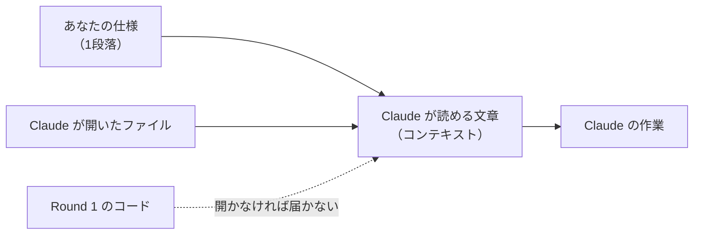
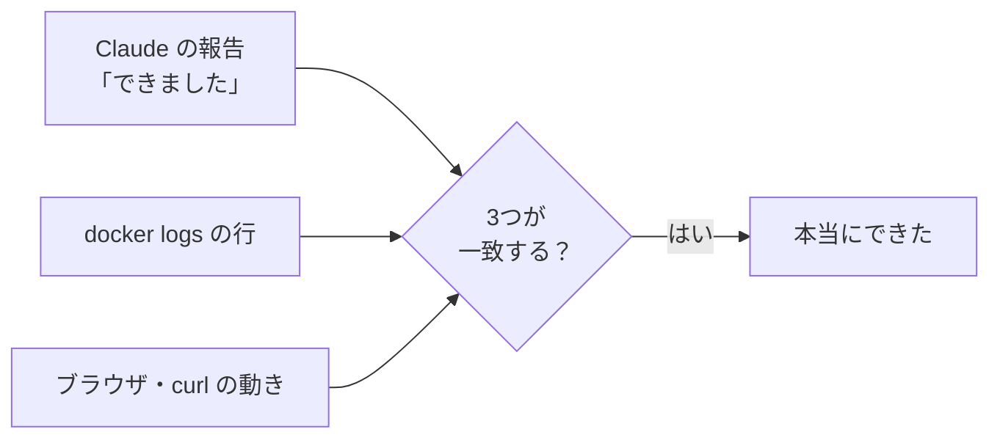

# 7-5 Round 2：同じものを Claude に作らせる

所要 45分 ／ 種類：覗く

## 今日のゴール
- 1段落の仕様で、Round 1 と同じメモアプリを **Claude に**作らせる
- Claude の「できました」を信じる前に、ログ・`curl`・ブラウザで**裏取り**する
- 自分のコードと見比べて、違いを3つ、自分の言葉で書く

**このレッスンでは Claude がコードを書きます**（0-1 と同じ）。あなたは「見る・聞く・疑う・確かめる」係です。Round 1 を手で作ったので、今日は Claude が出すものが全部読めるはずです。

## ステップ

### 1. 仕様に、全部書く

- **前提**：Claude は、会話を覚えているわけではありません。毎回、**渡された文章（コンテキスト）だけ**を読んで、次の作業を決めます（5-4、6-8）
- **困りごと**：「前と同じメモアプリを作って」では、何が「同じ」なのか Claude には分かりません。Round 1 のコードも、開かない限り読めません。足りないところは、Claude が**それらしく自分で決めて**しまいます
- **解決**：必要なことを、**1段落の仕様に全部書いて**渡します。今日は、Round 1 のコードを見ずに、この仕様だけから作ってもらいます

今日渡す仕様です（次のステップで貼ります）。

> playground/capstone-ai に、メモアプリを作って。Python の FastAPI と標準の sqlite3 だけで、GET /api/memos（一覧）、POST /api/memos（{"text": "..."} で追加。{"id", "text"} を返す）、DELETE /api/memos/{id}（削除）の3つのAPI。画面は static/index.html 1枚で、同じサーバーの API を fetch で呼ぶ。FastAPI から配信する。uv のプロジェクトにして、main.py に `app` を置く。DBファイルのパスは環境変数 MEMO_DB（無ければ memo.db）。Dockerfile も作って、ホストの 8001 番ポートで docker run して、動くところまでやって。Round 1 の playground/capstone は見ないで、この仕様だけから作って。何をやるか、先に3行で計画を教えて。

- 8001 番なのは、Round 1 の箱が 8000 番を使っているからです（7-3 のポートの話）

**確かめ**：この仕様から「DBファイルのパスは環境変数 MEMO_DB」の一文を消したら、Claude はどうする？ ボタン：`Round 1 と同じく、MEMO_DB を使う` / `DB の場所を、自分で適当に決める`
<!-- 先生用：自分で決める（memo.db に固定、など）。間違えたら「Claude は Round 1 で MEMO_DB を使ったことを知らない。コンテキストに無いことは伝わらない」と言い直す。困ること：/check や Docker が「別の場所の DB を使って」と指定できなくなる -->

### 2. 頼んで、計画を読む
**やってみよう**：
1. あなたのタブで、空の作業場所を作ります（コースのフォルダで）

   ```bash
   mkdir -p playground/capstone-ai
   ls playground/capstone-ai
   ```

   何も出なければ空っぽです。Round 1 の箱はそのまま動かしておいてOK（`docker ps` で見えます）
2. チャットに、ステップ1の仕様をそのまま貼って送ります
3. Claude が返す**3行の計画**を読みます

<!-- 先生用：ここからは先生自身が作り手になる。仕様どおり playground/capstone のコードは開かずに作る。計画を3行で出したら、受講者が読んで答えるまで作業を始めない -->

### 3. 作業中は、止めて聞いていい
Claude が作業を始めます。気になったら、いつでもチャットに書いてください。
- 「今何してる？」
- 「そのコマンドは何をするの？」
- 「なんでそのファイルを作るの？」

**許可のダイアログ**（0-2）が出たら、押す前に「何を許可するのか」を自分で言ってみます。たぶんこのあたりです。

| ダイアログの中身 | 何をしようとしている？ | 習ったところ |
|---|---|---|
| ファイルを作る・書き換える | `main.py` などを書く | 1-2, 1-3 |
| `uv add` / `uv sync` | ライブラリを入れる | 2-1, 7-1 |
| `docker build` | 箱を作る | 7-3 |
| `docker run -p 8001:8000` | 箱を動かして、Mac の 8001 番につなぐ | 7-3 |
| `curl localhost:8001/...` | 自分で API を叩いて確かめる | 3-3, 7-1 |
| `lsof` / `kill` | ポートの犯人を探して止める | 4-1, 7-3 |

- 言えないときは、許可する前に聞くのが正解です
- 消すコマンド（`rm`、`docker rm`）や、見覚えのない場所への書き込みは、特に慎重に

### 4. 「できました」を裏取りする

- **前提**：Claude の「できました」は**言葉**です。何が起きたかは、ログと動きという**事実**の側にあります
- **困りごと**：AI は、動いていないものを「動いています」と言うことがあります（確かめ忘れ、勘違い）。信じて進むと、あとで大きく壊れます
- **解決**：同じ出来事を、何か所かから見ます。**全部が一致したら本物**です

**やってみよう**：Claude が「できました」と言ったら、あなたのタブで確かめます。
1. `docker ps`：箱は本当に動いていますか？ ポートは `8001->8000` ですか？
2. 先生がログ用のタブで `docker logs -f （箱の名前）` を流します
3. `curl -s localhost:8001/api/memos`：JSON の配列が返りますか？
4. ブラウザで `http://localhost:8001` を開き、メモを追加・削除します。ログに `POST` と `DELETE` の行が流れましたか？
5. `docker logs （箱の名前） | grep -i error`（`-i`＝ignore case：大文字小文字を区別しない）で、`Traceback` や `500` のようなエラーが隠れていないか見ます

**確かめ**：もし `curl` では返事が来るのに、ブラウザの画面が真っ白だったら、まずどこを見る？ ボタン：`docker logs の API のエラー` / `DevTools の Console と Network`
<!-- 先生用：DevTools（7-2）。curl で返事が来る＝API は生きているので、問題は画面の側（HTML や fetch の URL）にありそう。間違えたら「API は curl で動くと分かった。残る怪しい場所は画面だけ」と言い直す -->

### 5. 読んで、比べる
**やってみよう**：
1. あなたのタブで、Claude が作ったものを読みます

   ```bash
   ls playground/capstone-ai
   cat playground/capstone-ai/main.py
   cat playground/capstone-ai/Dockerfile
   ```

   Round 1 であなたが TODO を埋めた場所に、Claude は何を書いていますか？
2. 比べるための用紙をコピーします

   ```bash
   cp lessons/07-capstone/05-ai-rebuild/starter/COMPARE.md playground/capstone-ai/
   ```

3. `COMPARE.md` に、**違いを3つ**、自分の言葉で書きます。「ログで確かめたこと」も書きます

| 見どころ | Round 1 で関係したところ |
|---|---|
| SQL に値を渡すときの `?` | 7-1 ステップ5 |
| 存在しない id を消そうとしたとき（404？） | 7-1 のチャレンジ |
| 空のメモなど、入力のチェック | |
| Dockerfile の行の順番 | 7-3 ステップ2 |
| 画面のコードの長さ | 7-2 |

### 6. 機能をひとつ足してもらう
- **前提**：会話が長くなると、最初に言ったことは、長い文章の奥に埋もれていきます（6-8）
- **困りごと**：ここまでで会話はかなり長くなっています。「壊さないで」のような大事な約束も、埋もれると守られにくくなります
- **解決**：大事な約束は、**頼むたびに書き直します**。変えたところも、毎回教えてもらいます

**やってみよう**：Round 1 に無い機能を1つ選んで、Claude に頼みます（どれでもOK）。
- メモに「完了」のチェックを付けられる
- メモを編集できる
- 新しいメモが上に来る
- 空のメモや、長すぎるメモは追加できない

頼むときに、この2つを必ず添えます：「**既存の API は壊さないで**」「**変えたファイルと、どこを変えたかも教えて**」

終わったら、ステップ4の裏取りをもう一度（Claude が箱を作り直したかも確かめる）。変えられたところを自分で読んで、`COMPARE.md` の「追加してもらった機能」に書きます。

<!-- 先生用：コンテキストがかなり膨らんでいるはず。余裕があれば /context で中身を見せ、6-8 の話（長い会話は重く、指示が埋もれやすい）につなげてもよい -->

### 7. 0-1 の表を、もう一度
**やってみよう**：`lessons/00-intro/01-wow/README.md` を開いて、ステップ4の表（「Claude がやったこと」）をもう一度読んでください。

- 0-1 のとき「何それ？」だった行は、今どれだけ分かりますか？
- 今日のあなたは、Claude が出した全部を**読めて**、ログで**裏取り**して、自分のコードと**比べて**、**直してもらえ**ました

## チェック
`/check`：`playground/capstone-ai` に Claude が作ったアプリがあり、API が動き、`COMPARE.md` に違いが3つ（と、ログで確かめたこと・追加してもらった機能）書けていれば合格。

## AIとの関係
最初の5分間は、Claude がやったことを「眺める」だけでした。今は、**Claude に足りない情報を渡し、出てきたものを読み、ログで裏取りして、直してもらえます。** AI に任せる人と、AI の仕事を確かめられる人の差は、ここです。
