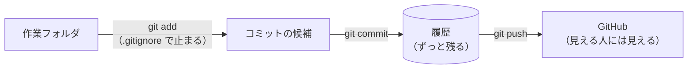
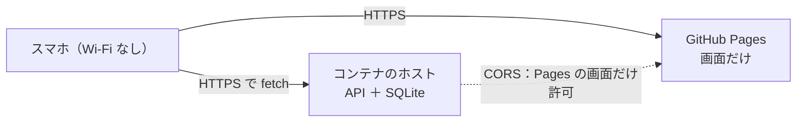

# 7-6 インターネットに出す（任意）

所要 30分 ／ 種類：作る

## 今日のゴール
- **公開してはいけないもの**を自分で見分けて、`.gitignore` で止める
- メモアプリを GitHub に置く（A：安全・おすすめ）
- やるなら、画面と API を別々の場所に出し、スマホの**モバイル回線**（Wi-Fi を切った状態）から開く（B）

**任意です。7-5 で終わってもかまいません。**

## ステップ

### 1. 先に考える：一度出したら、取り消せない

- **前提**：git は、コミットした中身を**履歴としてずっと覚えています**（1-7）。あとで消しても、昔のコミットには残っています。GitHub の公開リポジトリは、世界中から見えます
- **困りごと**：`memo.db`（あなたのメモ）や `.env`（パスワードや API キーの置き場、4-2）を一度でも入れて push すると、取り消しが効きません
- **解決**：**入れる前に止めます**。`.gitignore` に書いたものは、`git add` の段階で除外されます。秘密はコードに書かず、環境変数に置きます（4-2）

**確かめ**：`memo.db` をうっかりコミットし、次のコミットで消してから push しました。GitHub で、メモの中身は見える？ ボタン：`見えない` / `見える`
<!-- 先生用：見える。1つ前のコミット（履歴）に残っているから。間違えたら図の「履歴：ずっと残る」を指して「消したのは最新の形だけ。昔のコミットをたどれば中身が出てくる。だから入れる前に止める」と言い直す -->

### 2. 入れないものリストを書く
**やってみよう**：あなたのタブで（コースのフォルダから）コピーして、`TODO` を埋めます。

```bash
cp lessons/07-capstone/06-publish/starter/.gitignore playground/capstone/
```

- `TODO 1`：データベースのファイル名
- `TODO 2`：uv が作った Python の作業部屋のフォルダ（フォルダは最後に `/` を付ける）
- `.env` は、最初から書いてあります。今は使っていなくても、いつか秘密を置く場所なので

**確かめ**：`.venv/` を GitHub に入れないのに、別の Mac でこのアプリを動かせるのはなぜ？ ボタン：`pyproject.toml と uv.lock から、uv sync で作り直せるから` / `GitHub が、.venv を自動で用意してくれるから`
<!-- 先生用：uv sync で作り直せるから（7-1 ステップ3、7-3 の Dockerfile でも同じことをした）。間違えたら「.venv は、作り方メモ（pyproject.toml と uv.lock）から作れる、ただの結果。重くて Mac 専用でもある」と言い直す -->

### 3. コミットする前に、目で確かめる
**やってみよう**：あなたのタブで順番に打ちます。

```bash
cd playground/capstone
git init
git add .
git status
```

- `git init`＝initialize：このフォルダで git を始める
- `git status` に、**これからコミットされるファイル**の一覧が出ます
- **コミットする前に**、一覧をよく見ます。`memo.db`、`.venv`、`.env` は入っていませんか？ 入っていたら `.gitignore` を直して、`git add .` をやり直します
- 大丈夫なら、`git commit -m "first commit"`（`-m`＝message）

### 4. A：GitHub に置く
**やってみよう**：
1. ブラウザで GitHub を開き、新しいリポジトリを作ります。最初は **Private**（自分だけ見える）がおすすめです。アカウントの操作は、あなた自身が画面を見ながらやります
2. 作った画面に出る手順どおり、あなたのタブで `git remote add origin ...` と `git push` を打ちます（4-6 の復習）
3. GitHub の画面をリロードして、ファイルが並んでいれば成功です。`memo.db` が無いことも確かめます

ここまでで `/check` できます。続ける人は B へ。

### 5. B：画面と API を、別々の場所に置く

- **前提**：GitHub Pages は、**ファイルをそのまま配るだけ**の場所です（4-6）。FastAPI のような、動き続けるプログラムは置けません
- **困りごと**：画面と API を同じ場所から配る、という 7-2 の形が使えません
- **解決**：画面は Pages、API とデータベースは、コンテナを動かせるホストに置きます。そのかわり、直すところが出ます

| 直すところ | なぜ |
|---|---|
| 画面の `fetch` の URL を `https://（APIの住所）/api/memos` に | もう「同じ場所」ではないので、住所を全部書く |
| API に **CORS** の許可を足す。許可するのは**自分の Pages の住所だけ** | 別の場所からの呼び出しになったので（7-2 ステップ2） |
| `/manifest.json` のような `/` 始まりを `./manifest.json` に | Pages の住所は `https://〇〇.github.io/リポジトリ名/` と途中にフォルダが入るので |

**やってみよう**：**ここからの変更は Claude にやってもらいます。** チャットで、先に作戦会議をします。

> このアプリを、画面は GitHub Pages、API はコンテナを動かせるホストに出したい。変えるところを先に教えて。変えたら差分も見せて。

Claude が変えたら、**差分を自分で読み**、上の表の3つが入っているか確かめます。

### 6. B：ホストに出して、スマホで開く
**やってみよう**：
1. API を置くホストを選びます（4-6 の表を参考に）。**無料枠の条件はよく変わります。** 料金ページを自分で読み、次の2つを確かめてから進みます
   - クレジットカードの登録が要る？ → 要るなら、ここで止まって、本当に続けるか考えます。カード番号をチャットに貼るのは禁止です（自分で画面に入力します）
   - 無料枠を超えたら、自動で課金される？ 止める方法は？
2. ホストの手順に従って出します。うまくいかないところは、ログを読んで Claude と直します（ここまでの全部の復習です）
3. **スマホの Wi-Fi を切って**、`https://…` の画面を開き、メモを追加します。できたら成功です
4. 7-4 でできなかった「アプリをインストール」を、もう一度試します（SVG［**S**calable **V**ector **G**raphics：拡大しても荒れない画像］のアイコンしか無いと出ないことがあります。そのときは Claude に PNG のアイコンを足してもらいます）

公開するときの注意（大事）：
- **このアプリにはログインがありません。** URL を知った人は、誰でもメモを読めて、消せます。個人的なメモや本名は入れません
- **秘密を公開しません。** パスワード・API キー・`.env` は、コードにも GitHub にも画面（HTML/JS）にも書きません。`static/` の中身は世界中に丸見えです。いつか Claude の API をアプリから呼ぶときも、キーはサーバー側の環境変数（4-2）に置きます
- 公開の前に必ず `git status` と `git diff --stat`（`--stat`＝statistics：どのファイルが何行変わったか）で、**何が公開されるか**を自分の目で見ます
- 無料枠のホストでは、再起動でデータベースのファイルが消えることがあります。保存は「保証されないもの」として遊びます
- アカウント作成・支払いの設定・「許可する」ボタンは、必ずあなた自身が画面を見ながら押します。Claude に任せません
- 遊び終わったら、公開を止めます（ホストのサービスを削除、Pages を止める）

## チェック
`/check`：A の状態（`.gitignore` が正しく、`memo.db`・`.venv`・`.env`・秘密っぽい文字列がコミットに入っていない）なら合格。B（本当の公開）は、あなたの目で確かめてください。

## AIとの関係
Claude は「デプロイしました」「公開しました」と簡単に言いますが、**何が世界に見えるようになったか**は別の話です。公開の前に「何が見える？ 秘密は入ってない？」と自分で聞けて、`git status` で確かめられる人が、安心して AI に仕事を任せられます。
